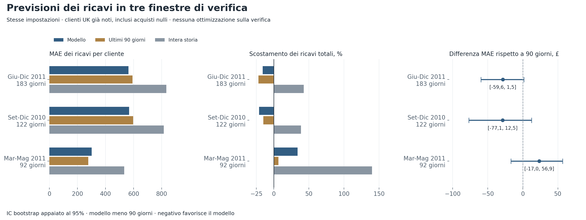
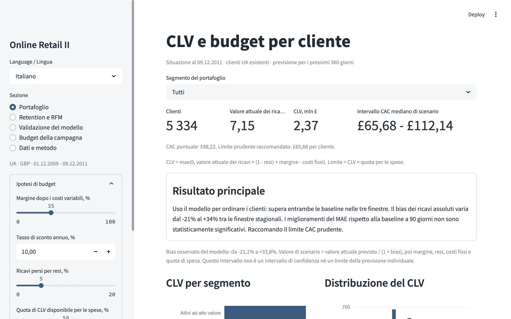
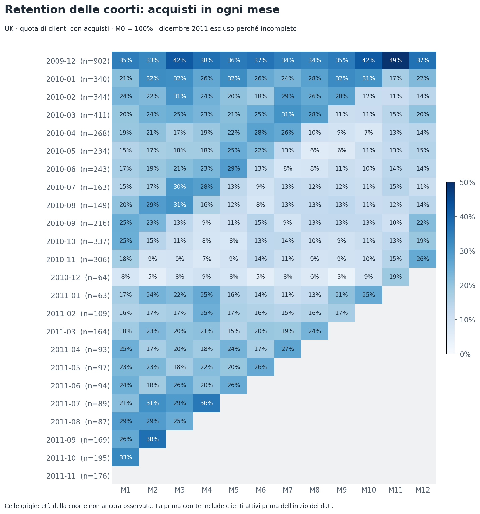
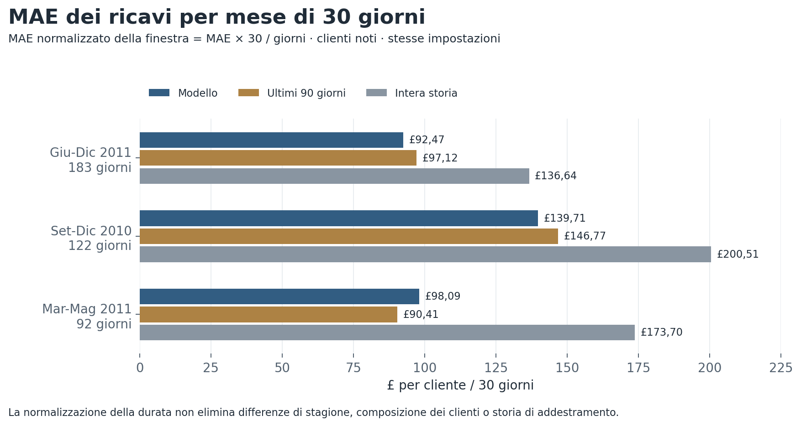
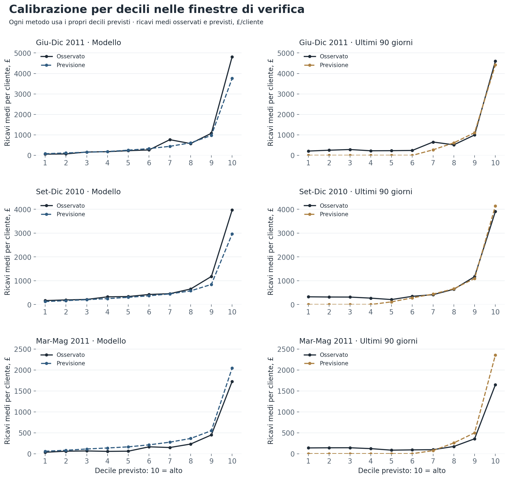
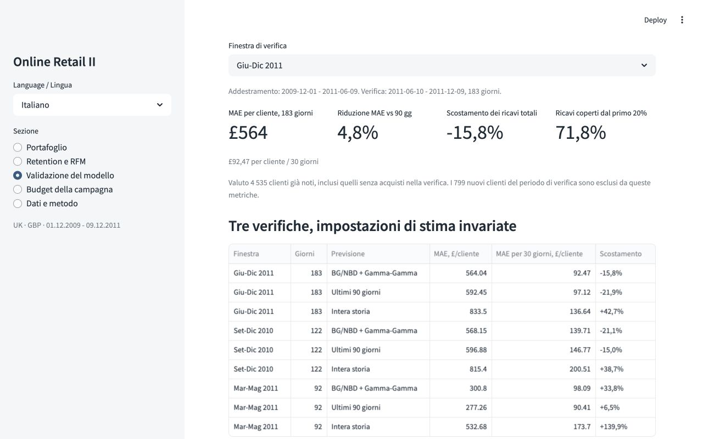
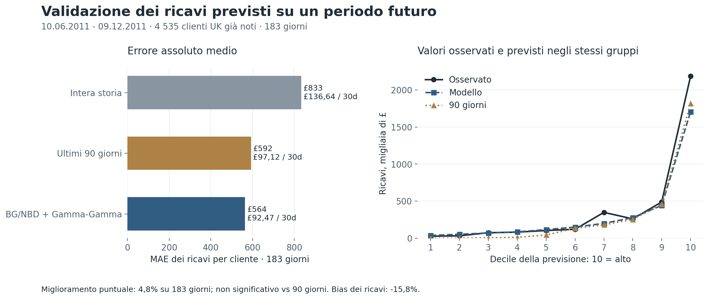
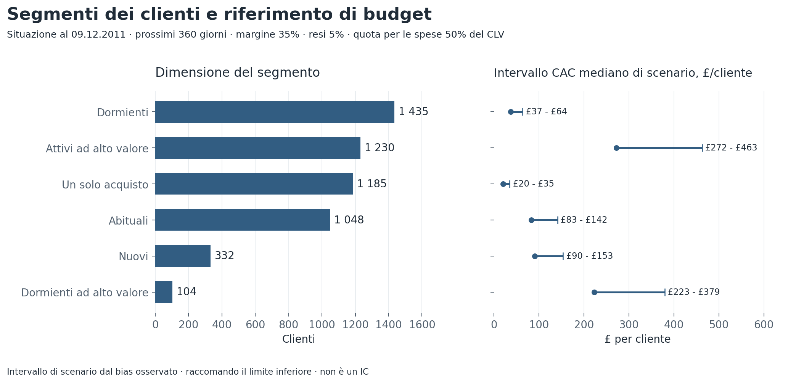
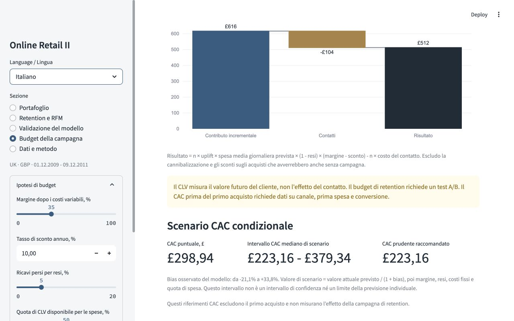
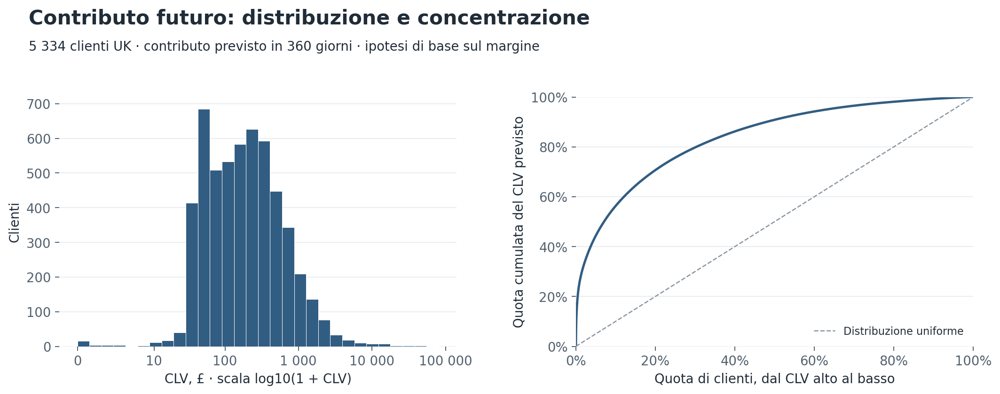

# Customer lifetime value e segmentazione per il commercio online

[English](README.md) | [Italiano](README.it.md)

## Una pagina per il responsabile

**Problema.** Un unico limite di spesa per acquisizione e retention ignora le differenze tra clienti. Ho stimato il valore futuro dei clienti e assegnato un'azione a ogni segmento.

**Metrica di business.** Il contributo economico previsto del cliente nei prossimi 360 giorni, in GBP. Lo uso per calcolare un riferimento CAC condizionale. Per la retention calcolo separatamente il contributo incrementale della campagna.

> **Risultato principale.** Uso il modello per ordinare i clienti: supera entrambe le baseline nella quota di ricavi del primo 10% e 20% e in Spearman nelle tre finestre. I ricavi assoluti hanno un bias da circa **-21% a +34%** tra le finestre stagionali. I miglioramenti del MAE rispetto alla baseline a 90 giorni **non sono statisticamente significativi**: ogni IC 95% appaiato include zero. Uso l’ordinamento per stabilire le priorità e raccomando il limite prudente dello scenario CAC.

**Risultato economico.** Con margine del 35%, perdita di ricavi per resi del 5% e costo fisso di £2 per cliente, il contributo futuro previsto del portafoglio è **£2,37 milioni**. L’intervallo CAC mediano di scenario è **£65,68-£112,14**; raccomando il limite inferiore. È una stima, non un profitto realizzato. Lo scenario di riattivazione di 104 clienti dormienti ad alto valore produce **+£512**: `104 × 2% × £891,32 × 95% × 35% - 104 × £1`. L'aumento di 2 punti percentuali della probabilità di acquisto è un'ipotesi.

**Raccomandazione.** Inizierei con un test di riattivazione con gruppo di controllo per questi 104 clienti e con l'onboarding di 332 nuovi clienti con un solo acquisto. Verificherei i limiti di acquisizione sulle coorti di ogni canale quando saranno disponibili i dati. Questo segmento dormiente è troppo piccolo per stimare da solo un uplift modesto con precisione.



## Demo e avvio

Ho creato cinque viste in Streamlit:

- Portafoglio: contributo dei segmenti, distribuzione CLV, filtro ed esportazione dei clienti.
- Retention e RFM: coorti, frequenza di acquisto, punteggi RFM e ricavi mensili.
- Validazione del modello: due baseline, errori, calibrazione per decili e previsioni mensili.
- Budget della campagna: contributo incrementale, costi dei contatti e uplift di pareggio.
- Dati e metodo: pulizia, definizioni e limiti.

Il selettore nella barra laterale passa tra **English** e **Italiano**, incluse etichette dei grafici, azioni, tabelle e download CSV dei clienti. Ogni README usa immagini nella propria lingua. Identificatori del codice e file analitici principali sono in inglese; includo anche esportazioni italiane dei clienti e della pulizia.

Margine, tasso di sconto annuo, resi, costi fissi e quota di CLV destinata alle spese sono ipotesi modificabili. Attualizzo i flussi nominali di `revenue_schedule.csv` per ogni mese del modello e ricalcolo esattamente il valore quando cambia il tasso annuo. Questi comandi modificano CLV e riferimenti CAC del portafoglio, non i backtest storici. Il filtro del portafoglio si applica a indicatori, grafici, tabella e CSV. Validazione e retention delle coorti usano popolazioni separate e fisse.



Ho verificato il progetto su Python 3.12.14. L'intervallo previsto è Python 3.10-3.12. I risultati pronti sono inclusi in `data/processed`, quindi la demo non richiede il file XLSX originale né l'addestramento dei modelli.

```bash
python -m venv .venv
source .venv/bin/activate
python -m pip install -r requirements.txt
python -m streamlit run app.py --server.port 8517
```

Apri `http://localhost:8517` e seleziona **Italiano**. In Windows l'ambiente si attiva con `.venv\Scripts\activate`.

Per ricalcolare dai dati originali UCI:

```bash
python -m src.pipeline --language it --margin 0.35 --annual-discount 0.10
python -m src.figures
python -m pytest -q
```

La pipeline scarica l'archivio UCI, legge entrambi i fogli e ricrea i risultati. Il primo ricalcolo richiede internet e circa 45 MB per il file originale. Se il file è già disponibile:

```bash
python -m src.pipeline --raw data/raw/online_retail_II.xlsx --language it
```

`--margin` imposta il margine di contribuzione e `--annual-discount` il tasso annuo, con valori predefiniti 0.35 e 0.10. `--language en` imposta i messaggi della pipeline in inglese. `src.figures` genera PNG in entrambe le lingue; `--language en` o `--language it` genera una sola versione. Gli screenshot sono acquisiti dall'applicazione in esecuzione e non vengono ricreati dal comando dei grafici.

## Dati, pulizia, retention e RFM

Ho usato [Online Retail II, UCI](https://archive.ics.uci.edu/dataset/502/online+retail+ii), Daqing Chen, 2012, [DOI 10.24432/C5CG6D](https://doi.org/10.24432/C5CG6D). Contiene transazioni reali di un negozio online britannico dal 1 dicembre 2009 al 9 dicembre 2011. Limito il progetto ai clienti United Kingdom. La valuta è GBP.

Il dataset è distribuito con licenza [CC BY 4.0](https://creativecommons.org/licenses/by/4.0/). Ho modificato i dati filtrando righe e aggregando gli acquisti. Non includo il file originale; includo dati puliti e tabelle derivate.

| Passaggio di pulizia | Righe eliminate | Righe rimanenti |
|---|---:|---:|
| Dati originali | 0 | 1 067 371 |
| Duplicati esatti | 34 335 | 1 033 036 |
| Customer ID mancante | 235 151 | 797 885 |
| Fuori dal Regno Unito | 81 770 | 716 115 |
| Annullamenti e resi | 15 681 | 700 434 |
| Prezzo nullo o negativo | 46 | 700 388 |
| Righe non relative a prodotti | 780 | 699 608 |

Richiedo che StockCode dei prodotti corrisponda a `\d{5}[A-Za-z]*`. Escludo così spedizioni, commissioni, rettifiche manuali e altre righe di servizio, ma potrei escludere codici di prodotto non standard. Considero i duplicati esatti ripetizioni tecniche; il dataset non consente di dimostrarlo per ogni riga.

I dati puliti contengono **30 014 giorni di acquisto per cliente** e **£14 288 759 di ricavi positivi da prodotti**. Non sono ricavi netti perché i resi storici non sono stati sottratti. Le perdite per resi futuri sono un'ipotesi separata.

Un acquisto del modello indica un giorno con acquisti del cliente. Unisco più fatture dello stesso cliente nello stesso giorno, quindi la spesa prevista è giornaliera e non necessariamente riferita a una sola fattura.

Fonte, date, SHA-256 del file originale e parametri sono in [metadata.json](data/processed/metadata.json). Il registro della pulizia è in [cleaning_it.csv](data/processed/cleaning_it.csv), con [versione analitica inglese](data/processed/cleaning.csv).

Una coorte è il mese del primo acquisto osservato. La retention M1 è la quota che acquista nel mese solare successivo. Un cliente può saltare un mese e tornare dopo, quindi la retention non deve necessariamente diminuire sempre.

La retention M1 ponderata è **23,5%**: clienti tornati divisi per la dimensione totale delle coorti con M1 interamente osservato. Escludo tutto dicembre 2011 perché incompleto. Le celle future non osservate restano vuote; i mesi osservati senza acquisti valgono zero.



R indica i giorni dall'ultimo acquisto, F i giorni con acquisti e M i ricavi positivi cumulati. I punteggi 1-5 usano ranghi percentili; un acquisto più recente aumenta R. I valori uguali ricevono lo stesso punteggio, quindi i gruppi non contengono necessariamente il 20% ciascuno. I segmenti operativi usano anche età del cliente, 90 giorni di inattività e CLV previsto. Sono regole di business, non politiche di campagna ottimizzate.

## Modello e verifica temporale

Ho usato `lifetimes` e verificato le definizioni nella sua [documentazione](https://lifetimes.readthedocs.io/en/latest/Quickstart.html). Eseguo la stessa pulizia, i riepiloghi cliente, i modelli e le baseline su tre date fisse. L'addestramento parte sempre dal 1 dicembre 2009 e termina alla data indicata. La verifica inizia il giorno dopo. Riaddestro il portafoglio finale fino al 9 dicembre 2011 solo dopo la valutazione.

| Finestra | Fine addestramento | Verifica | Giorni | Clienti noti | Noti, zero acquisti | Nuovi, esclusi |
|---|---|---|---|---|---|---|
| Giu-Dic 2011 | 2011-06-09 | 2011-06-10 - 2011-12-09 | 183 | 4 535 | 2 187 | 799 |
| Set-Dic 2010 | 2010-08-31 | 2010-09-01 - 2010-12-31 | 122 | 3 054 | 1 171 | 923 |
| Mar-Mag 2011 | 2011-02-28 | 2011-03-01 - 2011-05-31 | 92 | 4 149 | 2 693 | 354 |

Includo tutti i clienti osservati entro ogni data, anche quelli senza acquisti nella verifica. Escludo i nuovi clienti dalle metriche del portafoglio esistente. I loro ricavi sono £641 934, £589 460 e £173 939 rispettivamente per Giu-Dic 2011, Set-Dic 2010 e Mar-Mag 2011. Queste metriche non coprono tutte le vendite del negozio. Mostro ogni MAE con la durata della finestra e lo normalizzo anche per mese di 30 giorni. Orizzonti, storie di addestramento e popolazioni cambiano: anche i MAE normalizzati richiedono contesto.

Per BG/NBD, `frequency` indica i giorni ripetuti: giorni totali meno uno. `recency` indica i giorni tra primo e ultimo acquisto; `T` l'età dal primo acquisto alla data finale. La recenza del modello differisce dalla recenza RFM. Gamma-Gamma usa clienti ripetuti in addestramento con spesa ripetuta positiva. La loro spesa media giornaliera esclude il primo giorno di acquisto. I clienti senza ripetizioni usano la media di popolazione, quindi il modello non li distingue in base alla prima spesa.

La regolarizzazione BG/NBD resta fissa a 0.001. Gamma-Gamma non usa regolarizzazione e impone `q >= 1`; richiedo `q > 1.01` prima della previsione. Non scelgo modelli, baseline o date in funzione degli esiti di verifica.

Il calcolo originale di lifetimes ha prodotto 121 previsioni non finite in Set-Dic 2010 perché un logaritmo riceveva un valore ipergeometrico negativo. Valuto la stessa formula BG/NBD con una trasformazione di Eulero algebricamente equivalente. I parametri stimati restano invariati, ogni cliente ha una previsione finita e la finestra originale coincide con la precedente implementazione entro circa `3.5e-12` giorni di acquisto. Non elimino questi clienti né cambio la regolarizzazione.

Confronto due baseline fisse, con `H` pari ai giorni di verifica:

1. Intera storia: `giorni con acquisti / (T + 1) × H`, moltiplicati per la spesa media giornaliera storica. Include il primo giorno ed è instabile per clienti molto recenti.
2. Ultimi 90 giorni: acquisti e ricavi degli ultimi 90 giorni di addestramento, moltiplicati per `H / 90`. La finestra è uguale per tutti e include anche giorni precedenti al primo acquisto dei clienti recenti.

### Errori dei ricavi e stagionalità del bias

| Finestra | MAE modello | MAE 90 giorni | MAE intera storia | Bias modello | Bias 90 giorni | Bias intera storia |
|---|---|---|---|---|---|---|
| Giu-Dic 2011 (183 giorni) | £564,04 | £592,45 | £833,50 | -15,8% | -21,9% | +42,7% |
| Set-Dic 2010 (122 giorni) | £568,15 | £596,88 | £815,40 | -21,1% | -15,0% | +38,7% |
| Mar-Mag 2011 (92 giorni) | £300,80 | £277,26 | £532,68 | +33,8% | +6,5% | +139,9% |

Il bias è `(totale previsto - totale osservato) / totale osservato`. Il MAE è l'errore assoluto medio per cliente, inclusi i clienti senza acquisti. Evito MAPE perché alcuni valori osservati sono nulli.

Nella finestra originale di 183 giorni il MAE è inferiore del 4,8% alla baseline recente e del 32,3% all'intera storia. In Set-Dic 2010 (122 giorni) è inferiore del 4,8% alla baseline recente; nel periodo non di punta Mar-Mag 2011 (92 giorni) è **superiore dell'8,5%**. Il modello non è sempre migliore della baseline recente.

**Il bias originale di -15,8% è stagionale?** L'andamento è compatibile con una calibrazione che varia per stagione: il modello sottostima entrambe le finestre con il periodo autunnale/natalizio (-15,8% e -21,1%) e sovrastima il periodo non di punta (+33,8%). Questi backtest non dimostrano che la stagionalità causi tutto il bias originale. Cambiano anche durata dell'addestramento, orizzonte, composizione dei clienti e spese elevate. Servirebbero orizzonti uguali e più anni per separare gli effetti. Non ho adattato una correzione stagionale a queste verifiche.

Nella finestra originale i ricavi osservati dei clienti noti sono **£3 722 638**, contro **£3 135 866** previsti. Il MAE dei giorni di acquisto su 183 giorni è **1,04** per il modello e **1,16** per la baseline recente (0,170 e 0,190 per mese di 30 giorni); il bias del totale degli acquisti è **+0,7%**. Il RMSE dei ricavi è £3 330,25 contro £3 293,99 della baseline recente, **peggiore dell'1,1%**. WAPE è 68,7% contro 72,2%. Il divario dei ricavi maggiore del bias degli acquisti indica un ruolo delle stime di spesa e della distribuzione delle spese elevate, senza identificare una sola causa.

### MAE per mese di 30 giorni

Riporto `MAE della finestra × 30 / giorni della finestra`, in GBP per cliente per mese di 30 giorni. Elimina la differenza di scala della durata; non è il MAE di singole previsioni mensili. Domanda stagionale, composizione dei clienti e storia di addestramento restano diverse: questa normalizzazione non rende equivalenti i backtest.

| Finestra e durata | MAE modello / 30 giorni | MAE 90 giorni / 30 giorni | MAE intera storia / 30 giorni |
|---|---:|---:|---:|
| Giu-Dic 2011 (183 giorni) | £92,47 | £97,12 | £136,64 |
| Set-Dic 2010 (122 giorni) | £139,71 | £146,77 | £200,51 |
| Mar-Mag 2011 (92 giorni) | £98,09 | £90,41 | £173,70 |



### Ordinamento dei clienti e calibrazione

| Finestra | Previsione | Ricavi nel primo 10% | Ricavi nel primo 20% | Spearman |
|---|---|---|---|---|
| Giu-Dic 2011 | BG/NBD + Gamma-Gamma | 58,7% | 71,8% | 0,623 |
| Giu-Dic 2011 | Ultimi 90 giorni | 56,0% | 68,1% | 0,526 |
| Giu-Dic 2011 | Intera storia | 54,6% | 69,5% | 0,574 |
| Set-Dic 2010 | BG/NBD + Gamma-Gamma | 50,1% | 65,0% | 0,505 |
| Set-Dic 2010 | Ultimi 90 giorni | 49,4% | 64,2% | 0,455 |
| Set-Dic 2010 | Intera storia | 45,4% | 59,5% | 0,467 |
| Mar-Mag 2011 | BG/NBD + Gamma-Gamma | 57,7% | 72,7% | 0,517 |
| Mar-Mag 2011 | Ultimi 90 giorni | 55,1% | 67,0% | 0,432 |
| Mar-Mag 2011 | Intera storia | 55,8% | 71,9% | 0,463 |

Ogni metodo ordina i clienti noti secondo la sua previsione prima di osservare gli esiti. Le quote selezionano `ceil(numero clienti × quota)` clienti; a parità di previsione mantengo l'ordine degli ID cliente. Il numeratore è il loro ricavo osservato; il denominatore è il ricavo osservato di tutti i clienti noti. Spearman per l'ordinamento correla ricavi previsti e osservati per cliente, inclusi gli zeri.

Il modello cattura più ricavi in entrambi i gruppi e ha Spearman maggiore delle due baseline in tutte le finestre. Questo sostiene la scelta delle priorità, non dimostra profitto pubblicitario incrementale. I decili di ogni metodo usano la sua previsione, da 1 (basso) a 10 (alto). I ricavi osservati dei decili possono differire perché i gruppi cambiano. Il precedente `deciles.csv` conserva i gruppi comuni definiti dal modello nella finestra originale.



### Bootstrap appaiato dei clienti

| Finestra | Baseline di confronto | MAE modello - MAE baseline | IC 95% bootstrap appaiato |
|---|---|---|---|
| Giu-Dic 2011 (183 giorni) | Ultimi 90 giorni | -£28,41 | [-£59,65; +£1,55] |
| Giu-Dic 2011 (183 giorni) | Intera storia | -£269,46 | [-£342,69; -£204,85] |
| Set-Dic 2010 (122 giorni) | Ultimi 90 giorni | -£28,73 | [-£77,06; +£12,51] |
| Set-Dic 2010 (122 giorni) | Intera storia | -£247,25 | [-£309,68; -£190,95] |
| Mar-Mag 2011 (92 giorni) | Ultimi 90 giorni | +£23,55 | [-£17,02; +£56,86] |
| Mar-Mag 2011 (92 giorni) | Intera storia | -£231,88 | [-£296,18; -£176,61] |

Estraggo **1 000 ricampionamenti appaiati dei clienti** con reinserimento e seme 42. Ogni campione usa gli stessi indici cliente per modello e baseline e calcola `MAE modello - MAE baseline`, in GBP per cliente. L'intervallo usa i percentili 2,5 e 97,5 delle differenze. Una differenza negativa favorisce il modello.

Tutti gli intervalli rispetto alla baseline recente includono zero. La differenza puntuale originale su 183 giorni di **-£28,41** ha IC 95% **[-£59,65; +£1,55]**: non considero conclusiva la riduzione del 4,8%. I tre intervalli rispetto all'intera storia sono inferiori a zero. Gli intervalli sono condizionati alle previsioni stimate fisse: non riaddestro in ogni ricampionamento. Non coprono incertezza dell'addestramento o shock stagionali futuri comuni, e i backtest non sono esperimenti indipendenti.

### Verifica dell'ipotesi Gamma-Gamma

| Finestra | Clienti ripetuti in addestramento | Pearson | Spearman |
|---|---|---|---|
| Giu-Dic 2011 | 3 063 | 0,070 | 0,266 |
| Set-Dic 2010 | 1 819 | 0,172 | 0,220 |
| Mar-Mag 2011 | 2 731 | 0,077 | 0,238 |

Queste correlazioni usano solo l'addestramento e confrontano frequenza dei giorni ripetuti e spesa media dei giorni ripetuti, non l'ordinamento sopra. Un Pearson basso non dimostra indipendenza. Le associazioni Spearman positive di 0,220-0,266 mostrano che l'ipotesi Gamma-Gamma è imperfetta in tutte le date.

Dopo la valutazione riaddestro sul periodo completo e mantengo separate le metriche. La previsione CLV a 360 giorni supera ancora l'orizzonte massimo verificato di 183 giorni.





## Contributo, CAC e azioni per segmento

Prevedo acquisti cumulativi a 30, 60, ..., 360 giorni, moltiplico l'incremento di ogni mese per la spesa giornaliera prevista e lo attualizzo. La somma è il valore attuale dei ricavi futuri. Esclude il primo acquisto già avvenuto.

| Ipotesi | Valore di base | Significato |
|---|---:|---|
| Orizzonte | 360 giorni | 12 mesi del modello da 30 giorni |
| Tasso di sconto annuo | 10% | Mensile: `1.1 ** (1/12) - 1` |
| Margine di contribuzione | 35% | Dopo costi dei prodotti e variabili, prima di marketing e imposte |
| Perdite da resi | 5% dei ricavi | Perdita ipotetica di ricavi futuri |
| Costi fissi | £2 per cliente | Nell'intero periodo previsto |
| Quota per le spese | 50% del CLV | Mantengo il restante 50% come riserva |

```text
Valore attuale = somma(flussi del mese / (1 + tasso annuo) ** (mese / 12))
CLV del cliente = max(0, valore attuale × (1 - resi) × margine - costo fisso)
Riferimento CAC condizionale = CLV del cliente × quota per le spese
Caso di base: max(0, valore attuale × 0,95 × 0,35 - £2) × 0,50
```

### Intervallo CAC di scenario e limite prudente

Uso il bias dei ricavi del modello osservato nelle tre verifiche come scenario di pianificazione: **da -21,1383% a +33,8088%**. Poiché `bias = (previsto - osservato) / osservato`, i ricavi impliciti sono `previsto / (1 + bias)`. Il bias positivo più alto produce lo scenario inferiore dei ricavi; quello negativo produce lo scenario superiore. Modifico i ricavi attualizzati prima di applicare margine, resi, costi fissi e quota di spesa. Mantengo invariate le previsioni e i parametri del modello.

```text
CAC inferiore = max(0, valore attuale / (1 + 0,338088...) × (1 - resi) × margine - costo fisso) × quota di spesa
CAC superiore = max(0, valore attuale / (1 - 0,211383...) × (1 - resi) × margine - costo fisso) × quota di spesa
Limite condizionale raccomandato = CAC inferiore
```

Con le ipotesi predefinite, la mediana del portafoglio è **£65,68-£112,14**, contro il riferimento puntuale di £88,22. Raccomando **£65,68** come riferimento prudente. Per esempio, £1 000 di valore attuale dei ricavi produce `max(0, £1 000 / 1,338088... × 0,95 × 0,35 - £2) × 0,50 = £123,24` al limite inferiore, contro il riferimento puntuale di £165,25.

È un **intervallo empirico di scenario**, non un intervallo di confidenza, un limite calibrato della previsione individuale o una garanzia. Il bias aggregato non deve necessariamente valere per ogni cliente o segmento, e queste finestre più brevi non validano il CLV a 360 giorni. Uso gli stessi fattori di scenario per tutti i clienti, mantengo fissi i segmenti e ricalcolo i limiti quando cambiano i parametri economici. Sostituirei questo intervallo di stress con una calibrazione prospettica e coorti di acquisizione specifiche per canale.

Sommo i CLV individuali dopo averli limitati inferiormente a zero. Applicare la formula una sola volta al totale del portafoglio darebbe un risultato leggermente diverso.

Il valore alto corrisponde al 25% superiore del valore attuale dei ricavi futuri, da **£1 199,71**. Prima separo clienti nuovi e clienti con un solo acquisto. Tra chi ha acquisti ripetuti, oltre 90 giorni senza acquisti significa dormiente; i clienti ad alto valore senza questa pausa sono attivi ad alto valore. L'appartenenza ai segmenti è fissa al 9 dicembre 2011 e resta fissa alla fotografia predefinita quando cambio margine o tasso di sconto nella demo.

| Segmento | Clienti | CLV mediano | CAC puntuale | Intervallo CAC di scenario | Limite inferiore raccomandato | La mia azione |
|---|---:|---:|---:|---:|---:|---|
| Attivi ad alto valore | 1 230 | £730 | £365 | £272,41-£462,90 | £272,41 | Offerte personali senza sconti generalizzati |
| Dormienti ad alto valore | 104 | £598 | £299 | £223,16-£379,34 | £223,16 | Test di riattivazione con gruppo di controllo |
| Abituali | 1 048 | £223 | £111 | £83,01-£141,55 | £83,01 | Consigli sui prodotti e riordino semplice |
| Nuovi | 332 | £242 | £121 | £90,03-£153,46 | £90,03 | Onboarding dopo il primo acquisto |
| Un solo acquisto | 1 185 | £54 | £27 | £20,03-£34,69 | £20,03 | Email a basso costo per il secondo ordine |
| Dormienti | 1 435 | £100 | £50 | £37,13-£63,70 | £37,13 | Email occasionali senza costosa personalizzazione |



Questi riferimenti dipendono dalla storia osservata dei clienti esistenti. Non offrirei direttamente £365 o £299 per acquisire un cliente ancora sconosciuto. Il CAC prima del primo acquisto richiede costo di acquisizione, prima spesa, canale e retention delle sue coorti. La mediana del segmento non sostituisce il limite individuale.

### Esempio di riattivazione

I 104 clienti dormienti ad alto valore hanno una spesa media giornaliera prevista di £891,32. Ipotizzo un giorno di acquisto aggiuntivo entro 90 giorni, uplift di 2 punti percentuali, costo di contatto £1 e nessuno sconto.

```text
Giorni di acquisto aggiuntivi: 104 × 0,02 = 2,08
Contributo incrementale: 104 × 0,02 × £891,32 × 0,95 × 0,35 = £616,44
Costi dei contatti: 104 × £1 = £104
Risultato dello scenario: £616,44 - £104 = +£512,44
Uplift di pareggio: £1 / (£891,32 × 0,95 × 0,35) = 0,337 punti percentuali
```

Il contributo incrementale atteso per contatto è **£5,93** con queste ipotesi. È separato dal riferimento CAC condizionale di £299 e non giustifica spendere £299 per la riattivazione.

La demo include lo sconto: `risultato = n × uplift × spesa × (1 - resi) × (margine - sconto) - n × costo del contatto`. Escludo cannibalizzazione e sconti sugli acquisti che avverrebbero anche senza contatto. Per il profitto reale della campagna serve un esperimento.





## Struttura e verifiche

```text
app.py                  demo Streamlit bilingue
src/data.py             caricamento, pulizia, variabili e retention
src/models.py           modelli, baseline, flussi e attualizzazione
src/validation.py       tre backtest condivisi e bootstrap
src/segments.py         segmenti e calcoli economici
src/pipeline.py         calcolo completo ed esportazioni
src/figures.py          grafici PNG inglesi e italiani
src/translations.py     testi italiani e formattazione numerica
tests/                  verifiche della pipeline e della lingua
data/processed/         risultati pronti, parametri e provenienza
reports/figures/en/     grafici e screenshot inglesi
reports/figures/it/     grafici e screenshot italiani
README.md               documentazione completa in inglese
requirements.txt        versioni delle librerie
```

Le tre finestre sono in [backtests_metrics.json](data/processed/backtests_metrics.json), con [riepilogo](data/processed/backtests_summary.csv), [previsioni per cliente](data/processed/backtests_predictions.csv), [decili per metodo](data/processed/backtests_deciles.csv) e [totali mensili](data/processed/backtests_monthly.csv). [validation.csv](data/processed/validation.csv) e [metrics.json](data/processed/metrics.json) conservano la finestra originale. Il portafoglio completo è in [customers.csv](data/processed/customers.csv); [revenue_schedule.csv](data/processed/revenue_schedule.csv) contiene ricavi nominali per cliente e mese del modello. L'[esportazione italiana dei clienti](data/processed/customers_it.csv) include azioni e budget. I parametri sono JSON, quindi non serve pickle per consultare i risultati.

Ho verificato pulizia e aggregazione giornaliera, assenza di dati futuri nell'addestramento, frequenza e spesa media, distinzione tra zero osservato e mese non osservato nella retention, formule di budget e campagna, clienti senza acquisti futuri nelle metriche e assenza di dati futuri nella baseline a 90 giorni. Verifico anche inversione del bias nel CAC, applicazione del limite a zero prima della quota di spesa, esportazioni tradotte degli intervalli e normalizzazione del MAE a 30 giorni. Verifico denominatori e parità nelle quote, correlazione di ordinamento, copertura dei decili, abbinamento e riproducibilità del bootstrap, previsioni finite al limite numerico, effetto dello sconto sul CAC, cambio lingua e selezione del segmento in Streamlit.

Ho confrontato ogni riepilogo cliente con `summary_data_from_transaction_data` di lifetimes: frequenza, recenza, T e valore monetario coincidono. Il valore attualizzato coincide con `customer_lifetime_value` entro l'arrotondamento numerico. Ho eseguito tutte le cinque viste nelle due lingue con Streamlit AppTest e controllato grafici e comandi nel browser. Gli screenshot mostrano solo l'applicazione, senza interfaccia del browser né cursore.

## Limiti e cosa farei dopo

- I dati terminano nel 2011. I risultati sono storici e non rappresentano il budget attuale di un negozio.
- BG/NBD ignora la stagionalità. Il bias è -15,8%, -21,1% e +33,8% nelle tre finestre. È compatibile con una calibrazione che varia per stagione, ma non separa l'effetto da orizzonte, storia e composizione dei clienti.
- La previsione a 360 giorni supera l'orizzonte massimo verificato di 183 giorni. Le storie cliente dei backtest si sovrappongono. Aggiungerei date successive con orizzonti uguali e verifica annuale su una storia più lunga.
- I grandi clienti all'ingrosso influenzano i risultati. Non li ho rimossi in base agli esiti della verifica. Separerei B2B e B2C e valuterei la sensibilità ai clienti più grandi.
- Molte righe non hanno Customer ID, quindi il portafoglio non copre l'intero negozio.
- I resi sono esclusi e i ricavi netti reali non sono ricostruiti. Collegherei i resi agli ordini originali e otterrei margini per prodotto.
- Il primo acquisto osservato non è necessariamente il primo in assoluto, soprattutto nella prima coorte.
- Frequenza in addestramento e spesa media dei giorni ripetuti hanno Pearson/Spearman 0,070/0,266, 0,172/0,220 e 0,077/0,238 nelle tre finestre. Un Pearson basso non dimostra indipendenza Gamma-Gamma; le associazioni positive per rango sono un limite. Verificherei modelli monetari alternativi ed effetti del tipo di cliente.
- BG/NBD assegna ai clienti con un solo acquisto probabilità di attività 1 per costruzione. Non la considero una prova di attività; la loro spesa è una stima di popolazione.
- Tutti gli intervalli bootstrap appaiati del MAE rispetto alla baseline recente includono zero. Sono condizionati alle previsioni stimate e non coprono incertezza futura del modello o della stagione. Gli intervalli di previsione individuali non sono disponibili. Aggiungerei stime di incertezza, per esempio con PyMC-Marketing, e scenari di stress sul margine.
- L’intervallo CAC di scenario usa bias aggregati di finestre storiche più brevi. Non è un intervallo di incertezza del cliente; raccomando il limite inferiore e lo validerei prospetticamente.
- Mancano canali, CAC reale ed esiti dei contatti. Aggiungerei dati di acquisizione e un test di riattivazione con controllo, poi confronterei profitto incrementale e costo dei contatti.

Uso il modello per stabilire priorità e calcolare scenari di spesa trasparenti. Non dichiaro guadagni realizzati dalle campagne.
