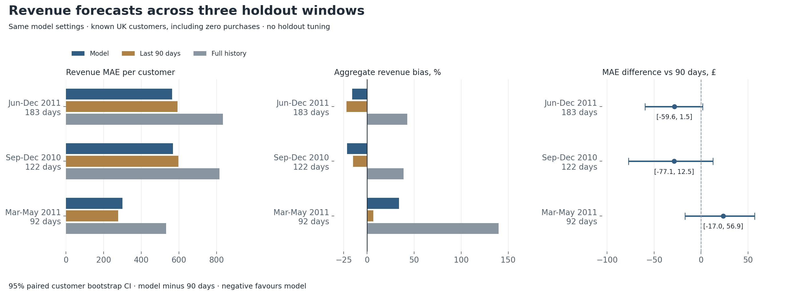
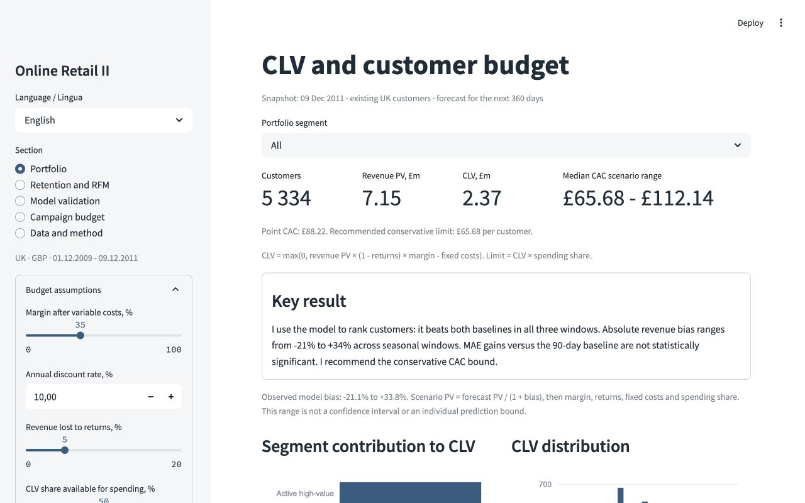
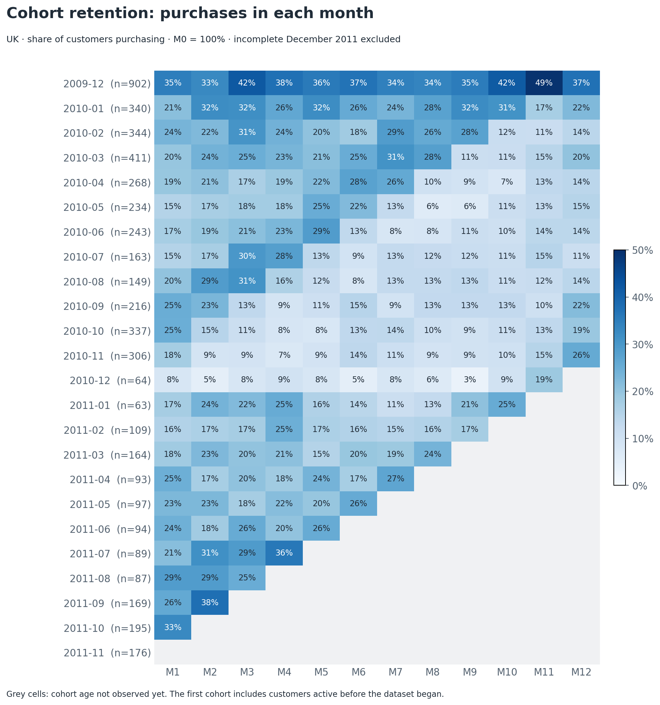
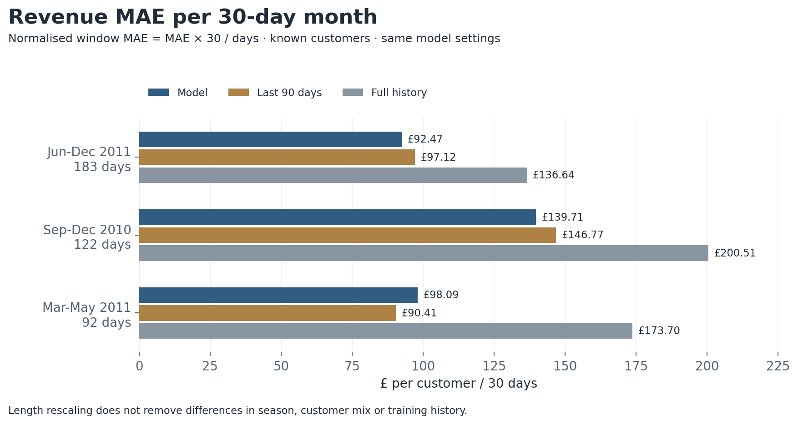
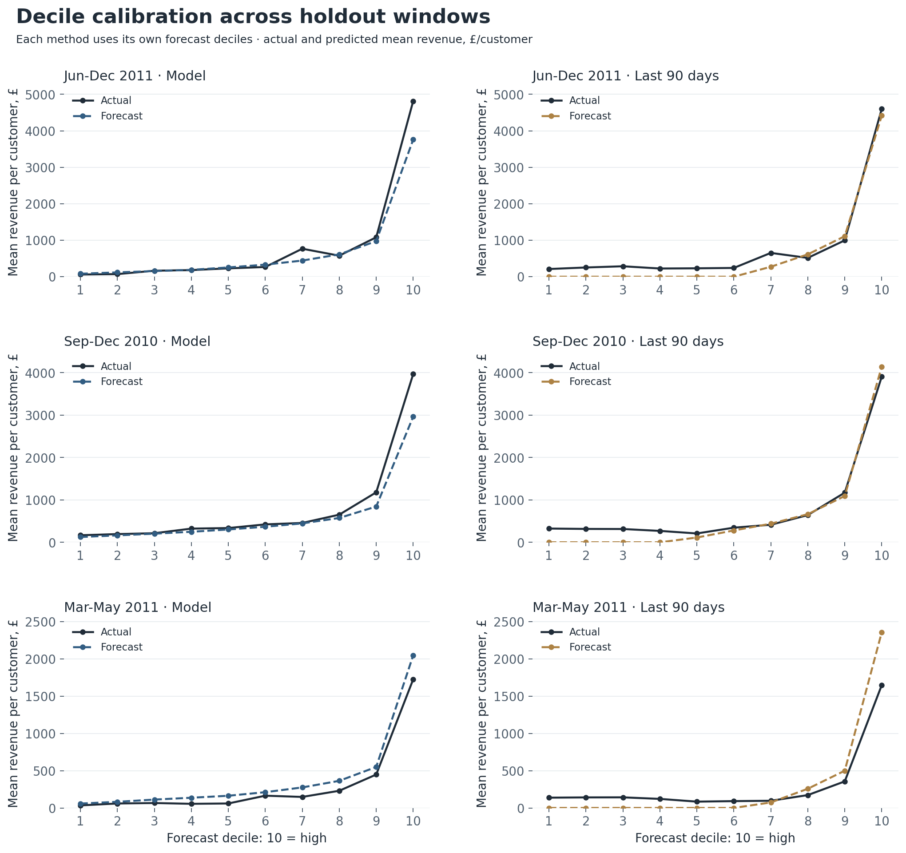
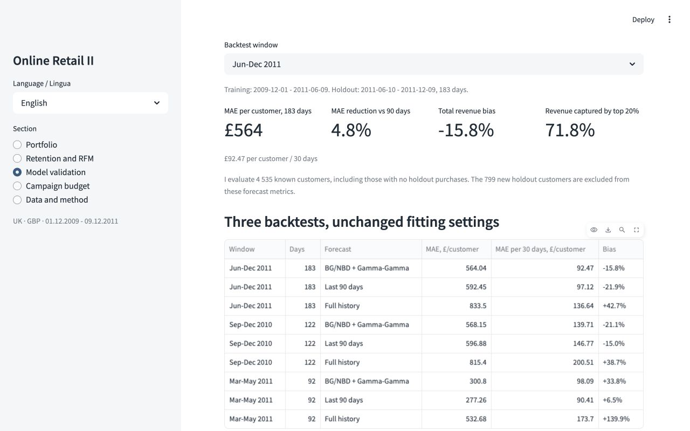
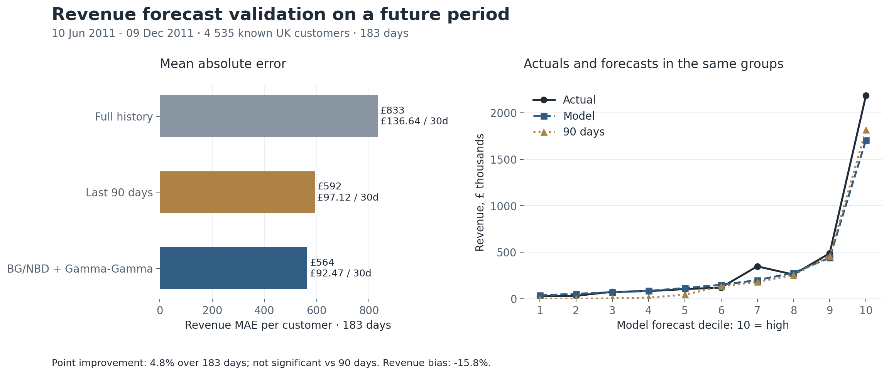
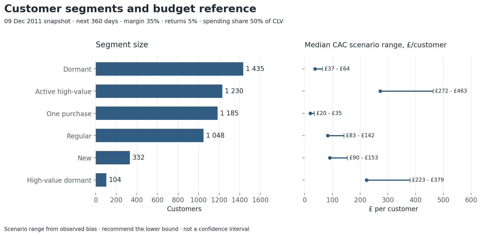
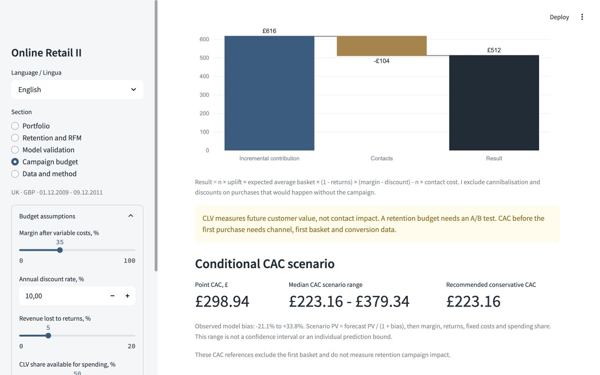
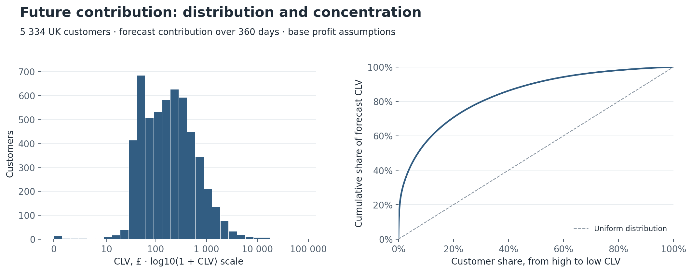

# Customer lifetime value and segmentation for online retail

[English](README.md) | [Italiano](README.it.md)

## One-page brief for a manager

**Problem.** A single acquisition or retention spending limit ignores differences between customers. I estimated future customer value and assigned an action to each segment.

**Business metric.** Expected customer contribution over the next 360 days, in GBP. I use it to calculate a conditional CAC reference. For retention, I calculate a campaign's incremental contribution separately.

> **Key result.** I use the model to rank customers: it beats both baselines on top-10% and top-20% revenue capture and Spearman in all three windows. Absolute revenue is biased from about **-21% to +34%** across seasonal windows. MAE gains versus the 90-day baseline are **not statistically significant**: every paired 95% CI includes zero. I use the ranking for customer priorities and recommend the conservative CAC scenario bound.

**Money.** With a 35% contribution margin, 5% revenue lost to returns and £2 fixed cost per customer, forecast portfolio contribution is **£2.37 million**. The median CAC scenario is **£65.68-£112.14**; I recommend the lower bound. This is an estimate, not realised profit. A reactivation scenario for 104 high-value dormant customers yields **+£512**: `104 × 2% × £891.32 × 95% × 35% - 104 × £1`. The additional 2 percentage points of purchase probability are an assumption.

**Recommendation.** I would start with a controlled reactivation test for these 104 customers and onboarding for 332 new customers with one purchase. I would validate acquisition limits using each channel's own cohorts once acquisition data is available. This dormant segment is too small to estimate a small uplift precisely on its own.



## Demo and setup

I built five Streamlit views:

- Portfolio: segment contribution, CLV distribution, a segment filter and customer export.
- Retention and RFM: cohorts, purchase frequency, RFM scores and monthly revenue.
- Model validation: two baselines, errors, decile calibration and monthly forecasts.
- Campaign budget: incremental contribution, contact costs and break-even uplift.
- Data and method: cleaning, definitions and limitations.

The sidebar language selector switches between **English** and **Italiano**, including chart labels, actions, tables and customer CSV downloads. Each README uses images in its own language. Code identifiers and canonical analytical files use English; Italian customer and cleaning exports are also included.

Margin, annual discount rate, returns, fixed costs and the CLV spending share are adjustable assumptions. I discount the nominal cashflows in `revenue_schedule.csv` separately for each model month and recalculate PV exactly when the annual rate changes. These controls change portfolio CLV and CAC references, not historical backtests. The portfolio filter applies to its cards, charts, table and CSV. Validation and cohort retention use their separate, fixed populations.



I tested the project on Python 3.12.14. Python 3.10-3.12 is the intended range. Prepared results are included in `data/processed`, so the demo does not need the original XLSX or model training.

```bash
python -m venv .venv
source .venv/bin/activate
python -m pip install -r requirements.txt
python -m streamlit run app.py --server.port 8517
```

Open `http://localhost:8517`. On Windows, activate the environment with `.venv\Scripts\activate`.

To rebuild from the original UCI data:

```bash
python -m src.pipeline --language en --margin 0.35 --annual-discount 0.10
python -m src.figures
python -m pytest -q
```

The pipeline downloads UCI's archive, reads both worksheets and recreates the outputs. The first rebuild requires internet access and about 45 MB for the original file. For an existing original download:

```bash
python -m src.pipeline --raw data/raw/online_retail_II.xlsx --language en
```

`--margin` sets contribution margin and `--annual-discount` sets annual discount, with defaults 0.35 and 0.10. `--language it` changes pipeline messages to Italian. `src.figures` creates English and Italian PNGs by default; `--language en` or `--language it` creates just one set. Screenshots are captured from the running app and are not recreated by the figure command.

## Data, cleaning, retention and RFM

I used [Online Retail II, UCI](https://archive.ics.uci.edu/dataset/502/online+retail+ii), Daqing Chen, 2012, [DOI 10.24432/C5CG6D](https://doi.org/10.24432/C5CG6D). It contains real transactions from a UK online retailer from 1 December 2009 to 9 December 2011. I restrict this project to customers in United Kingdom. The currency is GBP.

The dataset is licensed under [CC BY 4.0](https://creativecommons.org/licenses/by/4.0/). I modified it by filtering rows and aggregating purchases. The original file is not bundled; cleaned and derived data are included.

| Cleaning step | Rows removed | Rows remaining |
|---|---:|---:|
| Raw data | 0 | 1 067 371 |
| Exact duplicates | 34 335 | 1 033 036 |
| Missing Customer ID | 235 151 | 797 885 |
| Outside UK | 81 770 | 716 115 |
| Cancellations and returns | 15 681 | 700 434 |
| Zero or negative price | 46 | 700 388 |
| Non-merchandise lines | 780 | 699 608 |

I require merchandise StockCode values to match `\d{5}[A-Za-z]*`. This removes shipping, fees, manual adjustments and other service lines, but may also exclude unusual product codes. I treat exact duplicates as technical repeats; the dataset cannot prove this for every row.

The cleaned data contains **30 014 customer purchase days** and **£14 288 759 in positive merchandise revenue**. This is not net revenue because historical returns have not been deducted. Future return losses are a separate scenario assumption.

A model purchase means one customer purchase day. I combine multiple invoices placed by a customer on the same day, so the predicted basket is daily spending rather than necessarily one invoice.

Provenance, dates, the original XLSX SHA-256 and model parameters are in [metadata.json](data/processed/metadata.json). The audit is in [cleaning.csv](data/processed/cleaning.csv), with an [Italian export](data/processed/cleaning_it.csv).

A cohort is the month of the first observed purchase. M1 retention is the share purchasing in the next calendar month. Customers can skip a month and return later, so retention does not have to decline monotonically.

Weighted M1 retention is **23.5%**: returning customers divided by the total size of cohorts whose M1 is fully observed. I exclude incomplete December 2011 entirely. Future, unobserved cells remain blank; observed months without purchases are zero.



R is days since the last purchase, F is purchase days, and M is cumulative positive revenue. Scores 1-5 use percentile ranks; a more recent purchase raises R. Ties receive equal scores, so groups do not necessarily contain 20% each. Working segments also use customer age, a 90-day inactivity rule and forecast CLV. These are business rules, not optimised campaign policies.

## Model and honest temporal validation

I used `lifetimes` and checked definitions against its [documentation](https://lifetimes.readthedocs.io/en/latest/Quickstart.html). I run the same cleaning, customer summaries, models and baselines at three fixed cutoffs. Training always starts on 1 December 2009 and ends at the listed cutoff. Holdout starts the next day. I refit the final portfolio model through 9 December 2011 only after evaluation.

| Window | Training cutoff | Holdout | Days | Known customers | Known, zero purchases | New, excluded |
|---|---|---|---|---|---|---|
| Jun-Dec 2011 | 2011-06-09 | 2011-06-10 - 2011-12-09 | 183 | 4 535 | 2 187 | 799 |
| Sep-Dec 2010 | 2010-08-31 | 2010-09-01 - 2010-12-31 | 122 | 3 054 | 1 171 | 923 |
| Mar-May 2011 | 2011-02-28 | 2011-03-01 - 2011-05-31 | 92 | 4 149 | 2 693 | 354 |

I include every customer observed by the cutoff, including those with zero holdout purchases. New holdout customers are excluded from existing-portfolio metrics. Their revenue is £641 934, £589 460 and £173 939 for Jun-Dec 2011, Sep-Dec 2010 and Mar-May 2011 respectively. These metrics do not cover all store sales. I show each MAE with its window length and also rescale it per 30-day month below. Horizons, training histories and customer populations differ, so normalised MAEs still need context.

For BG/NBD, `frequency` is repeat purchase days: total purchase days minus one. `recency` is days between the first and last purchase; `T` is age since the first purchase at the cutoff. Model recency differs from RFM recency. Gamma-Gamma uses returning training customers with positive repeat spending. Their average daily basket excludes the first purchase day. Customers without repeats use the population mean, so the model does not distinguish them by their first basket.

BG/NBD regularisation stays fixed at 0.001. Gamma-Gamma has no regularisation and constrains `q >= 1`; I require `q > 1.01` before prediction. I do not tune models, baselines or cutoffs to holdout outcomes.

The original lifetimes prediction calculation returned 121 non-finite values in Sep-Dec 2010 when a logarithm received a negative hypergeometric value. I evaluate the same BG/NBD formula with an algebraically equivalent Euler transformation. Fitted parameters are unchanged, every customer has a finite forecast, and original-window predictions match the previous implementation within about `3.5e-12` purchase days. I do not drop these customers or change regularisation.

I compare two fixed baselines, where `H` is the holdout length in days:

1. Full history: `purchase days / (T + 1) × H`, multiplied by the historical average daily basket. This includes the first purchase day and is unstable for very young customers.
2. Last 90 days: purchases and revenue from the last 90 training days, multiplied by `H / 90`. The window is fixed for everyone, including days before a recent customer's first purchase.

### Revenue errors and seasonal bias

| Window | Model MAE | 90-day MAE | Full-history MAE | Model bias | 90-day bias | Full-history bias |
|---|---|---|---|---|---|---|
| Jun-Dec 2011 (183 days) | £564.04 | £592.45 | £833.50 | -15.8% | -21.9% | +42.7% |
| Sep-Dec 2010 (122 days) | £568.15 | £596.88 | £815.40 | -21.1% | -15.0% | +38.7% |
| Mar-May 2011 (92 days) | £300.80 | £277.26 | £532.68 | +33.8% | +6.5% | +139.9% |

Bias is `(total prediction - total actual) / total actual`. MAE is average absolute customer error, including zero-purchase customers. I avoid MAPE because some actuals are zero.

Original-window MAE over 183 days is 4.8% lower than the recent baseline and 32.3% lower than full history. In Sep-Dec 2010 (122 days) it is 4.8% lower than the recent baseline; in non-peak Mar-May 2011 (92 days) it is **8.5% higher**. The model is not uniformly better than the recent baseline.

**Is the original -15.8% bias seasonal?** The pattern is consistent with seasonal miscalibration: the model underpredicts both windows containing the autumn/Christmas period (-15.8% and -21.1%) and overpredicts the non-peak window (+33.8%). These backtests do not establish that seasonality causes the entire original bias. Training length, forecast horizon, customer mix and large baskets also differ. I would need matched horizons and more years to separate these effects. I have not fitted a seasonal correction on these holdouts.

Original-window actual known-customer revenue is **£3 722 638**, versus **£3 135 866** predicted. Purchase-day MAE over 183 days is **1.04** for the model and **1.16** for the recent baseline (0.170 and 0.190 per 30-day month); aggregate purchase bias is **+0.7%**. Model revenue RMSE is £3 330.25 versus £3 293.99 for the recent baseline, **1.1% worse**. WAPE is 68.7% versus 72.2%. The larger revenue shortfall points to spending estimates and the distribution of large baskets, without identifying one cause.

### MAE per 30-day month

I report `window MAE × 30 / window days`, in GBP per customer per 30-day month. This removes the duration scale difference; it is not the MAE of separate monthly forecasts. Seasonal demand, customer mix and training history still differ, so this rescaling does not make the backtests equivalent.

| Window and duration | Model MAE / 30 days | 90-day MAE / 30 days | Full-history MAE / 30 days |
|---|---:|---:|---:|
| Jun-Dec 2011 (183 days) | £92.47 | £97.12 | £136.64 |
| Sep-Dec 2010 (122 days) | £139.71 | £146.77 | £200.51 |
| Mar-May 2011 (92 days) | £98.09 | £90.41 | £173.70 |



### Customer ranking and calibration

| Window | Forecast | Revenue in top 10% | Revenue in top 20% | Spearman |
|---|---|---|---|---|
| Jun-Dec 2011 | BG/NBD + Gamma-Gamma | 58.7% | 71.8% | 0.623 |
| Jun-Dec 2011 | Last 90 days | 56.0% | 68.1% | 0.526 |
| Jun-Dec 2011 | Full history | 54.6% | 69.5% | 0.574 |
| Sep-Dec 2010 | BG/NBD + Gamma-Gamma | 50.1% | 65.0% | 0.505 |
| Sep-Dec 2010 | Last 90 days | 49.4% | 64.2% | 0.455 |
| Sep-Dec 2010 | Full history | 45.4% | 59.5% | 0.467 |
| Mar-May 2011 | BG/NBD + Gamma-Gamma | 57.7% | 72.7% | 0.517 |
| Mar-May 2011 | Last 90 days | 55.1% | 67.0% | 0.432 |
| Mar-May 2011 | Full history | 55.8% | 71.9% | 0.463 |

Each method ranks known customers using its own forecast before inspecting actuals. Top shares select `ceil(customer count × share)` customers; ties keep customer-ID order. The numerator is their actual holdout revenue; the denominator is all known customers' actual holdout revenue. Ranking Spearman correlates predicted and actual customer revenue, including zeros.

The model captures more revenue in both top groups and has higher ranking Spearman than both baselines in all three windows. This supports prioritisation, not an incremental advertising profit claim. Each method's deciles use its own forecast, from 1 (low) to 10 (high). Actual decile totals can differ because methods group customers differently. The older `deciles.csv` retains the original window's common, model-defined groups.



### Paired customer bootstrap

| Window | Compared baseline | Model MAE - baseline MAE | Paired bootstrap 95% CI |
|---|---|---|---|
| Jun-Dec 2011 (183 days) | Last 90 days | -£28.41 | [-£59.65; +£1.55] |
| Jun-Dec 2011 (183 days) | Full history | -£269.46 | [-£342.69; -£204.85] |
| Sep-Dec 2010 (122 days) | Last 90 days | -£28.73 | [-£77.06; +£12.51] |
| Sep-Dec 2010 (122 days) | Full history | -£247.25 | [-£309.68; -£190.95] |
| Mar-May 2011 (92 days) | Last 90 days | +£23.55 | [-£17.02; +£56.86] |
| Mar-May 2011 (92 days) | Full history | -£231.88 | [-£296.18; -£176.61] |

I draw **1 000 paired customer resamples** with replacement, using seed 42. Each draw uses identical customer indices for model and baseline and calculates `model MAE - baseline MAE`, in GBP per customer. The interval uses the 2.5th and 97.5th percentiles of those differences. A negative difference favours the model.

Every interval against the recent baseline includes zero. The original 183-day **-£28.41** point difference has 95% CI **[-£59.65; +£1.55]**, so I do not treat the 4.8% reduction as conclusive. All three intervals against full history are below zero. These intervals condition on fixed fitted predictions: I do not refit in each resample. They do not cover model-fitting uncertainty or shared future seasonal shocks, and the backtests are not independent experiments.

### Gamma-Gamma assumption check

| Window | Repeat training customers | Pearson | Spearman |
|---|---|---|---|
| Jun-Dec 2011 | 3 063 | 0.070 | 0.266 |
| Sep-Dec 2010 | 1 819 | 0.172 | 0.220 |
| Mar-May 2011 | 2 731 | 0.077 | 0.238 |

These are training-only correlations between repeat purchase-day frequency and average repeat purchase-day spending, not the ranking correlations above. Low Pearson does not establish independence. Positive Spearman associations of 0.220-0.266 show that the Gamma-Gamma independence assumption is imperfect across all three cutoffs.

After evaluation I refit on the full period and keep holdout metrics separate. The 360-day CLV forecast still extends beyond the longest validated horizon of 183 days.





## Contribution, CAC and segment actions

I forecast cumulative purchases at 30, 60, ..., 360 days, multiply each month's increase by expected daily spending and discount it. Their sum is future revenue PV. It excludes the first, already completed purchase.

| Assumption | Base value | Meaning |
|---|---:|---|
| Horizon | 360 days | 12 model months of 30 days |
| Annual discount | 10% | Monthly rate: `1.1 ** (1/12) - 1` |
| Contribution margin | 35% | After product and variable costs, before marketing and tax |
| Return losses | 5% of revenue | Assumed future revenue loss |
| Fixed costs | £2 per customer | Across the forecast period |
| Spending share | 50% of CLV | I keep the remaining 50% as a reserve |

```text
Revenue PV = sum(month cashflow / (1 + annual discount) ** (month / 12))
Customer CLV = max(0, revenue PV × (1 - returns) × margin - fixed cost)
Conditional CAC reference = customer CLV × spending share
Base case: max(0, revenue PV × 0.95 × 0.35 - £2) × 0.50
```

### CAC scenario range and conservative limit

I use the observed model revenue bias from the three holdouts as a planning scenario: **-21.1383% to +33.8088%**. Since `bias = (forecast - actual) / actual`, the implied revenue is `forecast / (1 + bias)`. The high positive bias gives the lower revenue scenario; the negative bias gives the upper scenario. I adjust discounted revenue before applying margin, returns, fixed costs and the spending share. I keep the model forecasts and fitted parameters unchanged.

```text
Lower CAC = max(0, revenue PV / (1 + 0.338088...) × (1 - returns) × margin - fixed cost) × spending share
Upper CAC = max(0, revenue PV / (1 - 0.211383...) × (1 - returns) × margin - fixed cost) × spending share
Recommended conditional limit = lower CAC
```

At the default assumptions, the portfolio median is **£65.68-£112.14**, versus a point reference of £88.22. I recommend **£65.68** as the conservative reference. For example, £1 000 revenue PV gives `max(0, £1 000 / 1.338088... × 0.95 × 0.35 - £2) × 0.50 = £123.24` at the lower bound, compared with the £165.25 point reference.

This is an **empirical scenario range**, not a confidence interval, a calibrated individual prediction bound or a guarantee. Aggregate holdout bias need not apply to every customer or segment, and these shorter windows do not validate 360-day CLV. I use the same scenario factors for all customers, keep segment membership fixed and recalculate bounds when economic parameters change. I would replace this stress range with prospective calibration and channel-specific acquisition cohorts.

I sum individual CLVs after flooring each at zero. Applying the formula once to the portfolio total would give a slightly different result.

High value means the top 25% of future revenue PV, starting at **£1 199.71**. I first separate new and one-purchase customers. Among returning customers, more than 90 days without a purchase means dormant; high-value customers without this gap are active high-value. Segment membership is fixed at 9 December 2011 and stays fixed at the default snapshot when I change margin or discount assumptions in the demo.

| Segment | Customers | Median CLV | Point CAC | CAC scenario range | Recommended lower bound | My action |
|---|---:|---:|---:|---:|---:|---|
| Active high-value | 1 230 | £730 | £365 | £272.41-£462.90 | £272.41 | Personal offers without blanket discounts |
| High-value dormant | 104 | £598 | £299 | £223.16-£379.34 | £223.16 | Reactivation test with a control group |
| Regular | 1 048 | £223 | £111 | £83.01-£141.55 | £83.01 | Recommendations and easy repeat ordering |
| New | 332 | £242 | £121 | £90.03-£153.46 | £90.03 | Onboarding after the first purchase |
| One purchase | 1 185 | £54 | £27 | £20.03-£34.69 | £20.03 | Low-cost emails for the second order |
| Dormant | 1 435 | £100 | £50 | £37.13-£63.70 | £37.13 | Occasional emails without expensive personalisation |



These references depend on observed customer histories. I would not directly bid £365 or £299 for an unknown prospect. CAC before the first purchase requires acquisition cost, first basket, channel and cohort retention data. A segment median also does not replace an individual customer's limit.

### Reactivation example

The 104 high-value dormant customers have expected average daily spending of £891.32. I assume one additional purchase day within 90 days, 2 percentage points of uplift, a £1 contact cost and no discount.

```text
Additional purchase days: 104 × 0.02 = 2.08
Incremental contribution: 104 × 0.02 × £891.32 × 0.95 × 0.35 = £616.44
Contact costs: 104 × £1 = £104
Scenario result: £616.44 - £104 = +£512.44
Break-even uplift: £1 / (£891.32 × 0.95 × 0.35) = 0.337 percentage points
```

Expected incremental contribution per contact is **£5.93** under these assumptions. It is separate from the £299 conditional CAC reference and does not justify spending £299 on reactivation.

The demo also models a discount: `result = n × uplift × basket × (1 - returns) × (margin - discount) - n × contact cost`. It excludes cannibalisation and discounts on purchases that would occur without contact. Real campaign profit needs an experiment.





## Project layout and checks

```text
app.py                  bilingual Streamlit demo
src/data.py             loading, cleaning, features and retention
src/models.py           models, baselines, cashflows and discounting
src/validation.py       shared three-window backtests and bootstrap
src/segments.py         segments and economics
src/pipeline.py         full calculation and exports
src/figures.py          English and Italian chart PNGs
src/translations.py     Italian text and number formatting
tests/                  pipeline and language checks
data/processed/         prepared results, parameters and provenance
reports/figures/en/     English figures and screenshots
reports/figures/it/     Italian figures and screenshots
README.it.md            full Italian documentation
requirements.txt        package versions
```

All three windows are in [backtests_metrics.json](data/processed/backtests_metrics.json), with the [summary](data/processed/backtests_summary.csv), [customer predictions](data/processed/backtests_predictions.csv), [method-specific deciles](data/processed/backtests_deciles.csv) and [monthly totals](data/processed/backtests_monthly.csv). [validation.csv](data/processed/validation.csv) and [metrics.json](data/processed/metrics.json) retain the original window. The full portfolio is in [customers.csv](data/processed/customers.csv); [revenue_schedule.csv](data/processed/revenue_schedule.csv) stores nominal revenue by customer and model month. An [Italian customer export](data/processed/customers_it.csv) includes actions and budgets. Model parameters are JSON, so viewing results does not require pickle.

I tested cleaning and daily aggregation, temporal leakage, frequency and basket definitions, observed zero versus unobserved retention cells, budget and campaign formulas, zero-actual customers in metrics, and future-data exclusion from the 90-day baseline. I also check CAC bias inversion, flooring before spending share, translated range exports and 30-day MAE rescaling. I check top-share denominators and ties, ranking correlation, decile coverage, bootstrap pairing and reproducibility, finite forecasts at the numerical boundary, discount effects on CAC, and the language switch and segment selection in Streamlit.

I independently compared every customer summary with lifetimes' `summary_data_from_transaction_data`; frequency, recency, T and monetary value matched. Discounted revenue matched its `customer_lifetime_value` within numerical rounding. I ran all five views in both languages with Streamlit AppTest and inspected charts and controls in the browser. Screenshots show only the app, without browser chrome or a cursor.

## Limitations and what I would do next

- The data ends in 2011. These results are historical and are not a current store budget.
- BG/NBD ignores seasonality. Bias is -15.8%, -21.1% and +33.8% across the three windows. This is consistent with seasonal miscalibration but does not isolate seasonality from horizon, training history and customer-mix effects.
- The 360-day forecast extends beyond the longest validated horizon of 183 days. Customer histories overlap between backtests. I would add rolling cutoffs with matched horizons and annual validation on longer histories.
- Large wholesale customers influence results. I did not remove them based on holdout outcomes. I would separate B2B and B2C and assess sensitivity to the largest customers.
- Many rows lack Customer ID, so the portfolio does not cover the entire store.
- Returns are excluded and actual net revenue is not reconstructed. I would link returns to original orders and obtain product-level margins.
- The first observed purchase is not necessarily the first-ever purchase, particularly in the first cohort.
- Training frequency versus average repeat-day spending has Pearson/Spearman 0.070/0.266, 0.172/0.220 and 0.077/0.238 across the windows. Low Pearson does not prove Gamma-Gamma independence; positive rank associations are a limitation. I would test alternative monetary models and customer-type effects.
- BG/NBD gives one-purchase customers an alive probability of 1 by construction. I do not use it as proof of activity; their basket is a population estimate.
- All paired MAE bootstrap intervals against the recent baseline include zero. They condition on fitted predictions and do not capture future model or seasonal uncertainty. Individual prediction intervals are unavailable. I would add uncertainty estimates, for example with PyMC-Marketing, and margin stress scenarios.
- The CAC scenario range uses aggregate biases from shorter historical windows. It is not a customer uncertainty interval; I recommend its lower bound and would validate it prospectively.
- Channels, actual CAC and contact outcomes are missing. I would add acquisition data and a controlled reactivation test, then compare incremental profit with contact cost.

I use the model to prioritise customers and calculate transparent spending scenarios. I do not claim realised campaign gains.

## Project code license

Copyright (c) 2026 Gr1gorii.

The original project code authored by Gr1gorii is licensed under the
GNU General Public License version 3 only (`GPL-3.0-only`).
See [LICENSE](LICENSE) for the full terms.

Third-party code, datasets, and materials retain their respective licenses
and attribution requirements. This license does not replace those terms.
